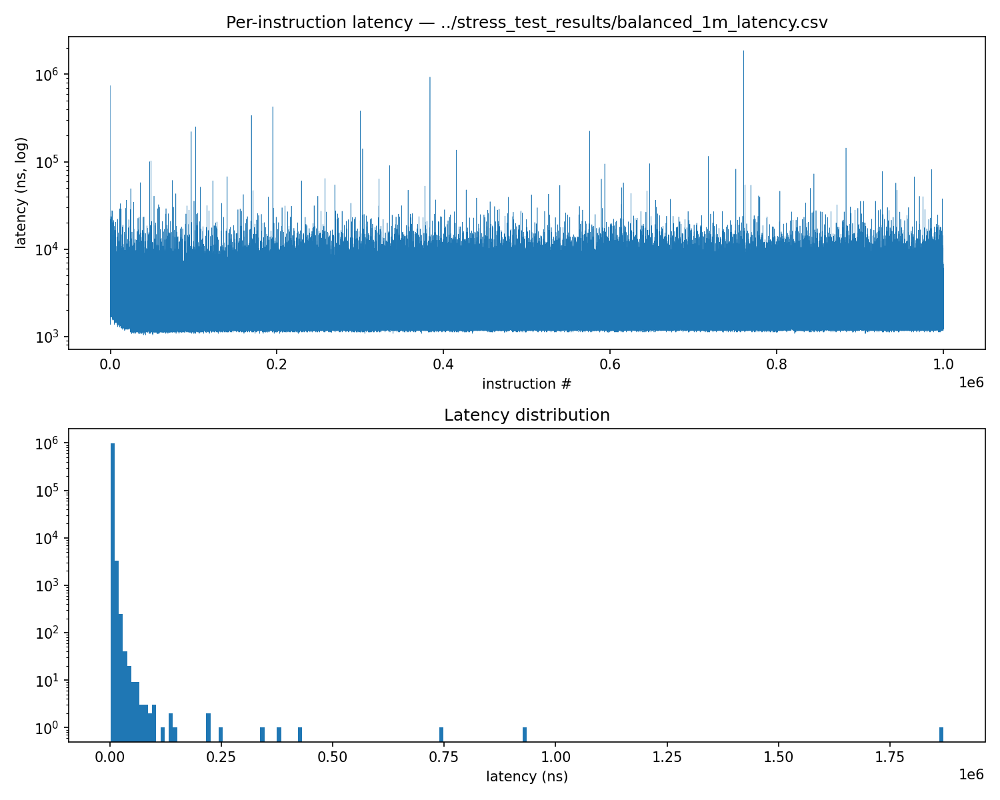
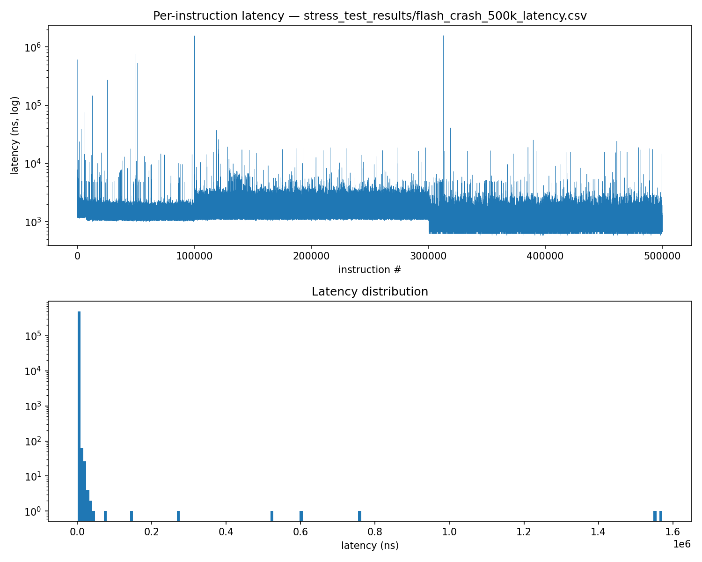
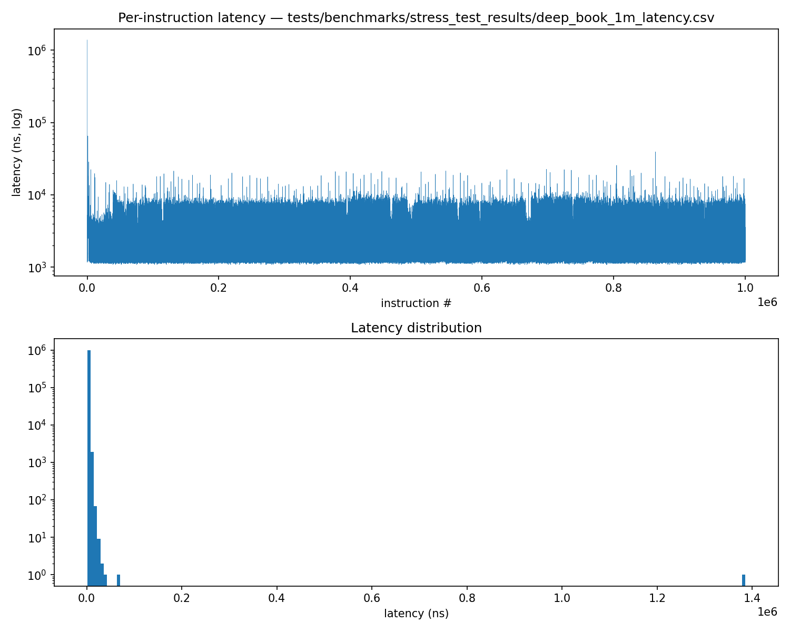
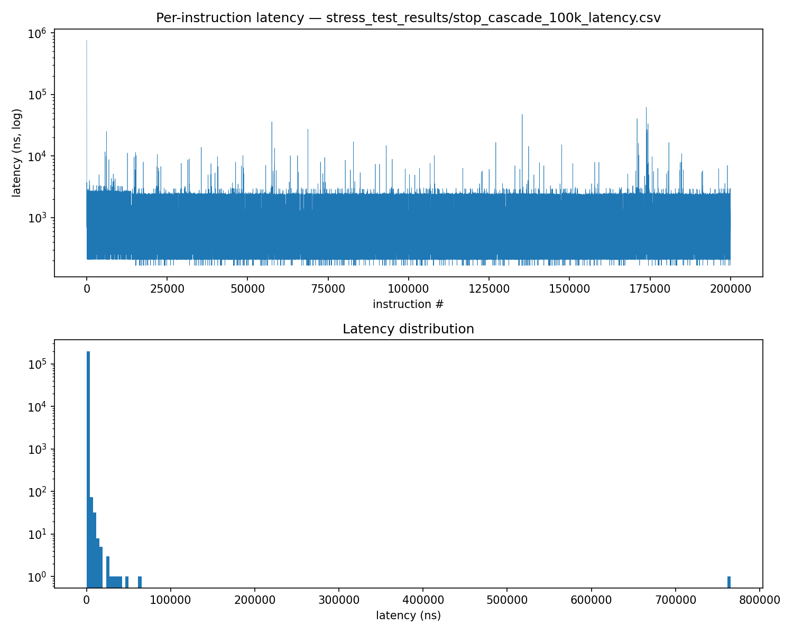
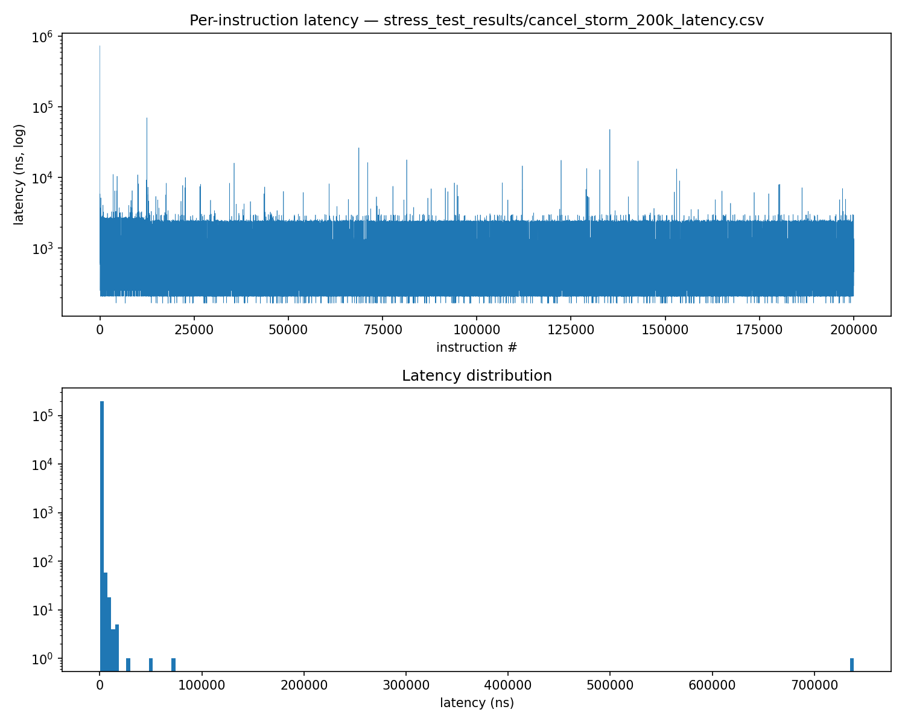

# Limit Order Book Engine

A C++20 exchange-style limit order book and matching engine implementing price-time priority, common order types, fill policies, and time-in-force semantics.

> **Project status: v2 actively under development**
>
> This branch contains the new architecture currently being implemented. The original working implementation is preserved on [`main`](../../tree/main) and tagged as [`v1.0.0`](../../releases/tag/v1.0.0).

## Overview

This project implements an exchange-style limit order book and matching engine in modern C++.

The v2 implementation is a ground-up architectural refactor of the original working implementation, with a focus on efficient order management, clean separation of responsibilities, testability, and measurable performance.

## V2 Architecture

The order book maintains separate bid and ask price levels using ordered maps:

```text
OrderBook
├── Bid Price Levels
│   └── PriceLevel
│       └── Orders
├── Ask Price Levels
│   └── PriceLevel
│       └── Orders
└── Order ID Index
    └── OrderLocation
```

Each resting order is stored in a linked list within its price level. An order-ID hash index stores the corresponding price level and list iterator.

This allows cancellation to avoid searching through an entire price level:

```text
Order ID
   ↓
Hash Index
   ↓
OrderLocation
   ↓
PriceLevel + list iterator
   ↓
O(1) average-case erase
```

Price-level operations use ordered maps, providing `O(log n)` lookup/insertion/removal at the price-level layer.

## Supported Order Types

* Limit
* Market
* Stop
* Stop-limit

## Order Policies

* Price-time priority
* Fill-or-kill (FOK)
* All-or-none (AON)
* Good-for-day (DAY)
* Good-til-cancelled (GTC)

## Complexity Goals

| Operation                              | Target Complexity |
| --------------------------------------- | -----------------: |
| Price-level lookup                     |        `O(log n)` |
| Price-level insertion/removal          |        `O(log n)` |
| Order ID lookup                        |    `O(1)` average |
| Order cancellation                     |    `O(1)` average |
| Order modification across price levels |        `O(log n)` |

## Why the Refactor?

The original implementation used sequential order containers within each price level. While effective for basic matching, arbitrary order removal required searching within the container.

The v2 design separates:

1. **Price-level indexing** using ordered maps
2. **Order sequencing** using linked lists
3. **Direct order access** using a hash index

This provides stable iterators for individual orders while preserving price-time ordering within each level.

## Repository Structure

```text
include/       Public headers
src/           Implementation
tests/         Unit tests
tools/         Standalone benchmarking, tracing, and profiling binaries
CMakeLists.txt Build configuration
README.md      Documentation
```

## Building

### Requirements

* C++20-compatible compiler
* CMake

### Build

```bash
cmake -S . -B build -DCMAKE_BUILD_TYPE=Release
cmake --build build
```

### Tests

```bash
ctest --test-dir build --output-on-failure
```

## Progress Tracking

* [x] Refactor project structure
* [x] Implement core order-book data structures
* [x] Implement direct order indexing
* [x] Implement cancellation
* [x] Add unit tests
* [x] Implement matching engine
* [x] Add comprehensive matching tests
* [x] Add stress-testing harness and synthetic order generation
* [x] Add latency profiling and visualization
* [ ] Add frontend with `ncurses`
* [ ] Analyze performance and data-structure tradeoffs against v1
* [ ] Merge v2 into `main`

## Stress Testing

Correctness alone doesn't prove an order book can hold up under realistic load, so this project includes a synthetic instruction generator and a set of adversarial scenarios designed to exercise specific failure modes rather than just "a lot of random orders."

Each scenario targets a different part of the engine:

* **`balanced`** — a steady, roughly even mix of buy/sell limit, market, and stop orders around a stable mid-price. This is the baseline case: no adversarial structure, just sustained ordinary trading activity. Used to establish a "normal operating" latency profile to compare every other scenario against.

* **`flash_crash`** — a book is seeded with resting liquidity, then hit with a sustained wave of aggressive sell orders (market orders and deliberately underpriced limit orders) against a trickle of buy orders. This simulates a liquidity crisis: the book is drained from one side far faster than it can be replenished. It stresses the "what happens when there's nothing left to match against" path — market orders hitting a near-empty or fully empty book, price levels collapsing rapidly, and repeated erasure of `PriceLevel` nodes from the map as the book empties out.

* **`deep_book`** — roughly a million resting limit orders placed far from any realistic spread (deep bids near the bottom of a price range, deep asks near the top), with no crossing at all. This tests raw data-structure scaling in isolation, with no matching logic involved: how the `std::map` of price levels behaves with many distinct price levels, how the `std::unordered_map` order index behaves at high load factor (including rehashing), and overall memory footprint at scale.

* **`stop_cascade`** — a dense cluster of stop orders is placed just below a support price, resting liquidity is built up above it, and then a single large market order is submitted to push the price down through that cluster. This is designed to trigger a cascading, recursive chain: each triggered stop becomes a new market/limit order, which can itself trigger further stops. It stresses the stop-triggering and order-requeueing logic specifically — the part of the engine most at risk of unbounded recursion, double-triggering, or subtly wrong price/time ordering under cascading conditions.

* **`cancel_storm`** — an interleaved stream where roughly every other instruction is a cancellation of a previously placed order, with a fraction of cancels deliberately targeting already-consumed or nonexistent order IDs. This isolates and stresses the `OrderId → OrderLocation` hash index and the O(1)-erase cancellation path specifically, independent of any matching activity.

Datasets are generated once, from a fixed seed, and stored as flat binary files so that both the current implementation and the `v1.0.0` baseline can be benchmarked against byte-identical input.

## Latency Profiling

Rather than relying solely on aggregate throughput numbers, each scenario is run through a dedicated latency harness (`tools/latency_profile.cc`) that times every individual instruction (nanosecond resolution) and records the full sequence to CSV, alongside a percentile summary (p50 / p90 / p99 / p99.9 / max). Aggregate benchmarking (Google Benchmark) is used separately for overall throughput comparisons between v1 and v2; the per-instruction profiler exists specifically to expose tail behavior and timing patterns that a single mean or median would hide.

Each scenario is visualized as a pair of charts: a per-instruction timeline (latency vs. instruction index, log-scaled y-axis) and a latency distribution histogram (log-scaled y-axis).

### Balanced



The timeline sits consistently in the 10³–10⁴ ns range with only occasional spikes reaching 10⁵–10⁶ ns — no sustained shift in behavior anywhere in the run, which is exactly what's expected of the baseline scenario: a steady mix of ordinary order types with no adversarial structure. The histogram peaks sharply near 0 ns (log scale) with a right-skewed tail extending out to roughly 1.75 (log₁₀ ns), consistent with the same "mostly cheap, occasionally expensive" shape seen throughout this project. This scenario's numbers serve as the reference point every other scenario below is implicitly compared against: any of them departing meaningfully from this shape (rather than just this scale) would be the signal worth investigating first.

### Flash Crash



The timeline hovers around 10³ ns with occasional spikes, similar in shape to the balanced case, but with two features specific to this scenario: spike frequency decreases noticeably after roughly the 100k-instruction mark, and overall latency drops below 10³ ns after roughly 300k instructions rather than merely spiking less often. The histogram is right-skewed and concentrated near 0 ns, with a longer outlier tail than the balanced case.

**What the timeline shows:** the occasional spikes throughout the run are expected and not concerning on their own. In a scenario that repeatedly drains price levels to empty and re-creates them, spikes typically correspond to one of a few known-expensive events rather than a systemic slowdown: a `std::map` node allocation/rebalance when a price level is inserted or erased, or an `order_index_` rehash once the hash table's load factor crosses its threshold. The reduction in spike frequency after ~100k instructions is itself informative — it suggests whichever mechanism is responsible is winding down as the run progresses, which fits the map-node-churn explanation better than periodic rehashing (rehashing frequency wouldn't be expected to decrease as more elements are inserted; if anything the reverse). What to check specifically: cross-reference spike locations in the CSV against the corresponding lines in a `simulate.cc` trace of the same dataset, and confirm whether they cluster around instructions that erase many price levels in quick succession.

**What the sustained drop after ~300k instructions shows:** unlike an isolated spike, a sustained decrease in latency points to a change in the *shape* of the work being done, not a one-off expensive operation. The most likely explanation given this scenario's design: once the aggressive sell-side pressure has fully drained the resting bid liquidity seeded at the start, later sell orders increasingly find an empty or near-empty book, and matching against nothing is cheap. The *early* instructions are doing real matching work across populated price levels; the *later* instructions are largely falling into the fast "no liquidity, cancel immediately" path. To confirm this directly rather than by inference: plot resting bid depth (or bid-side level count) over the same instruction range and check whether it flatlines to near-zero around the same index where the latency drop occurs. If so, the drop is a direct, expected consequence of the scenario's design — the book genuinely runs dry — not a bug.

**What the histogram shows:** the right-skewed shape — a tall concentration at low latency with a long, thin tail — is why percentiles rather than a mean are used throughout this project. A right-skewed histogram means the mean is pulled upward by a small number of expensive operations and therefore overstates "typical" cost while understating how rare the worst cases actually are. The tail's extent (how far right it reaches, and how many instructions fall in it) is the number worth reporting explicitly — e.g., "99.9% of instructions completed in under X ns; the remaining 0.1% extended up to Y ns" — rather than collapsing the distribution into a single average.

### Deep Book



The timeline shows one large spike at the very beginning of the run, with no comparable spike recurring afterward — subsequent spikes top out around 10⁴, occasionally approaching 10⁵, but nothing near the initial one. The histogram shows very few outliers, tightly concentrated near 0 ns.

This "one big spike, then clean" shape is distinct from flash crash's recurring-but-decreasing spikes, and it points to a different cause: a **one-time setup cost** rather than an ongoing, periodically-triggered one. The leading candidate is `order_index_`'s very first hash-table allocation and its early rehashes — an `unordered_map` starts small and grows by rehashing as it fills, and with a million resting orders being inserted in sequence, the first several rehashes will land early in the run when the table is still small, cheap to grow, and being resized repeatedly in quick succession before it stabilizes into its final capacity. Once the table has grown past the point where further rehashes are needed (or become infrequent enough not to show up at this granularity), insertion cost flattens out — consistent with the near-total absence of further large spikes. This is directly testable: calling `order_index_.reserve(expected_count)` up front, before the run starts, should eliminate this opening spike if the diagnosis is correct — worth trying as a concrete before/after comparison rather than leaving it as an inferred explanation.

The overall flatness after the opening spike is the more important result for this scenario specifically: `deep_book` exists to test raw data-structure scaling with no matching logic involved, and a flat post-warmup timeline is exactly what the `O(log n)` price-level and `O(1)`-average order-index complexity targets predict. *(To fully validate the complexity claim, run this scenario at multiple depths — e.g. 10k / 100k / 1M resting orders — and confirm p99 stays flat rather than growing as depth increases; a single run at 1M shows the shape but not the scaling trend.)*

### Stop Cascade



The timeline shows spikes spread fairly evenly across the run, with the single largest spike occurring at the very beginning and reaching roughly 10⁶ ns — an order of magnitude above the rest of the spikes, which mostly sit around 10⁴–10⁵ ns. Spike frequency increases somewhat around the 175k-instruction mark. The histogram has few outliers, is right-skewed, and concentrates near 0 ns.

The evenly-distributed spikes are consistent with this scenario's design: stop orders are triggered repeatedly and recursively throughout the run rather than in one single event, so recurring, moderate-sized spikes matching each triggering event are expected. The one large early outlier is worth investigating specifically rather than folding into the general pattern — this scenario deliberately builds a dense stop cluster and then submits a single massive market order intended to cascade through it, and if that submission occurs early in the instruction sequence, its outsized latency (recursively reprocessing every triggered stop within one `submit()` call) would appear as exactly this kind of isolated, unusually large early spike. Confirm by checking the instruction index of the large market order in the dataset against the index of this spike in the CSV — if they match, this is the expected cost of resolving the entire cascade in a single call, not a bug. The secondary increase in spike frequency around 175k is worth checking against the trace as well, since it could indicate a second, smaller cascade forming from stop orders whose trigger prices sit further from the initial cluster.

### Cancel Storm



The timeline shows its largest spike at the very beginning, with smaller, fairly even spikes continuing throughout the run in the 10⁴–10⁵ range. The histogram shows few outliers, is right-skewed, and concentrates near 0 ns.

The pattern here mirrors `deep_book`'s opening spike (likely early `order_index_` rehashing as the book fills before the cancel/submit interleaving begins) combined with `flash_crash`'s ongoing-but-modest spike pattern (consistent with occasional map-node churn as price levels are created and emptied by the interleaved submit/cancel stream). The number that matters most for this scenario, though, isn't the timeline shape — it's the cancel-specific percentile figures. *(To get this: split the CSV by the `action` column and compute p99/p99.9 for `cancel` rows in isolation from `submit` rows. This isolates the cost of the O(1)-average `OrderId → OrderLocation` hash lookup and `std::list` iterator erase specifically, which is the number that most directly supports the cancellation design's complexity claim — the combined timeline includes submit-path cost that dilutes this signal.)*

## Correctness Validation

In addition to the unit test suite (`ctest`), a standalone trace tool (`tools/simulate.cc`) replays a dataset against the engine and prints every execution report in sequence, including all fills produced. This was used during development to catch behavioral bugs that pass/fail unit tests alone did not immediately surface — for example, a matching-direction bug where a sell limit order was incorrectly permitted to cross against resting bids priced below its limit, caught by visually inspecting a trace and noticing a fill price inconsistent with the incoming order's stated limit. That specific case was captured as a regression test (`SellLimitDoesNotCrossBelowItsLimitPrice`).

## Roadmap

* Run the full scenario suite against both `v1.0.0` and the current `v2` branch on identical datasets, and report side-by-side throughput and tail-latency comparisons.
* Investigate and document the source of the flash-crash timeline spikes directly (map churn vs. hash rehashing) rather than by inference from the chart alone.
* Add a `ncurses` frontend for interactive/manual order entry against a running book.

## Stable Baseline

The original implementation remains available on [`main`](../../tree/main) and is tagged [`v1.0.0`](../../releases/tag/v1.0.0).

The stable implementation is intentionally preserved as a baseline for comparison and regression testing while v2 is developed.